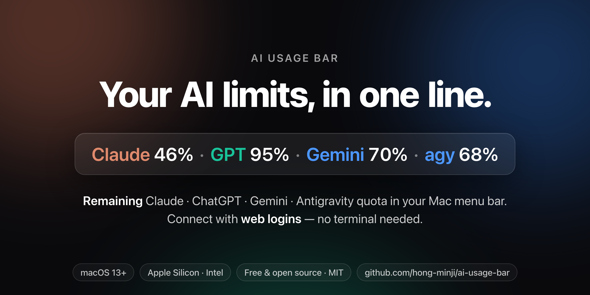
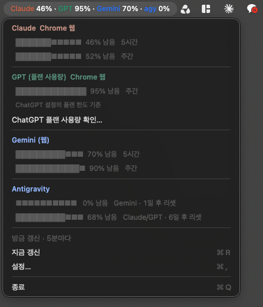
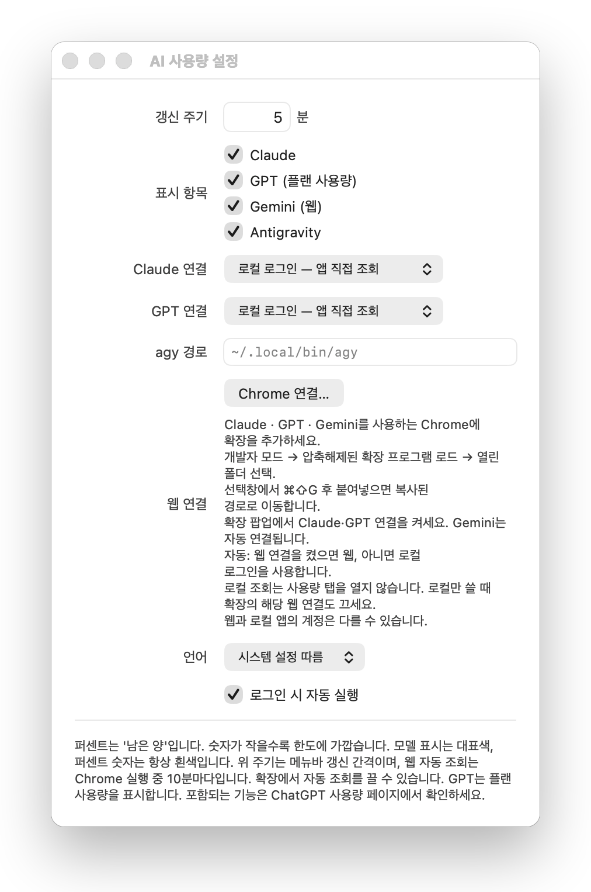

<h1 align="center">AI Usage Bar</h1>

<p align="center">
  <b>Your remaining Claude · ChatGPT · Gemini quota, in one line on your Mac menu bar.</b><br>
  Stop opening settings pages to find out how much you have left.
</p>

<p align="center">
  <a href="https://github.com/hong-minji/ai-usage-bar/releases/latest"></a>
  
  
  <a href="LICENSE"></a>
  <a href="https://github.com/hong-minji/ai-usage-bar/actions/workflows/ci.yml"></a>
</p>

<p align="center">
  <a href="README.md">한국어</a> · <b>English</b>
</p>

<p align="center">
  
</p>

<p align="center">
  <a href="https://github.com/hong-minji/ai-usage-bar/releases/download/v1.3.0/AIUsageBar-1.3.0-universal.zip"><b>↓ Download for Mac — v1.3.0</b></a>
  &nbsp;·&nbsp; <a href="#install">Install</a>
  &nbsp;·&nbsp; <a href="#connect-your-services">Connect</a>
  &nbsp;·&nbsp; <a href="https://github.com/hong-minji/ai-usage-bar/releases">Releases</a>
  &nbsp;·&nbsp; <a href="https://github.com/hong-minji/ai-usage-bar/issues">Report an issue</a>
</p>

A free, open-source Mac menu bar app that shows how much of your Claude, ChatGPT/Codex, Gemini and Antigravity allowance is left, side by side. **Connect with the web logins you already have in Chrome, with no terminal or CLI**, or keep using existing Claude Code and Codex logins and the agy CLI. Runs on macOS 13 or later, on both Apple Silicon and Intel.

> [!NOTE]
> The app's interface is currently Korean. This guide gives each label in Korean with its English meaning, so setup works either way.

## Why AI Usage Bar?



- **One line, counting what's left.** The menu bar reads “Claude 46% · GPT 95%” and so on. Every number is what **remains**, not what you used, so a smaller number means you are closer to the limit. When a service has both a five-hour and a weekly window, the bar shows the tighter one.
- **Web logins, no terminal.** Being signed in to Claude, ChatGPT and Gemini in Chrome is enough. There is no CLI to install and no API key to create.
- **Gemini web quota too.** It shows the gemini.google.com allowance, and the Antigravity (agy) coding quota separately.
- **A web connection that leaves cookies and tokens alone.** The bundled Chrome extension reads only the figures shown on each usage page and passes them to this Mac. It does not read cookies, passwords or conversations.
- **Checks usage without calling a model.** No prompts are sent. The app itself measured about 30–35 MB of memory on the test Mac.
- **Never invents a `0%`.** If a check fails, you see the last good reading, how old it is, and the error.
- **Small and transparent.** No developer server, analytics, ads or telemetry. It is written in Swift and JavaScript with no third-party libraries, and builds with only Xcode Command Line Tools.

<br clear="right">

The screenshot is the actual app; values change with usage. Open the menu for each service's individual limits and reset times where available.

## Install

No terminal, Xcode, Homebrew or Node.js required.

1. Download **[AIUsageBar-1.3.0-universal.zip](https://github.com/hong-minji/ai-usage-bar/releases/download/v1.3.0/AIUsageBar-1.3.0-universal.zip)**. The same file supports Apple Silicon and Intel.
2. Double-click the ZIP to extract it. It contains `AIUsageBar.app`, `START-HERE.txt` and `LICENSE.txt`.
3. **Move the app to Applications before opening it.** Choose its permanent location before connecting Chrome.
4. Find the app in the menu bar at the top of the screen. Open **설정…** (Settings) → **표시 항목** (Visible items) and keep only the services you use. There is no Dock icon.
5. Connect your services using whichever option fits under [Connect your services](#connect-your-services).

> [!IMPORTANT]
> This is an early public release. It is ad-hoc signed, without Apple Developer ID signing or notarization, so macOS may block the first launch. Read [First launch](#first-launch) below. Windows and Linux are not supported.

GitHub's **Code → Download ZIP** and the **Source code** release assets contain source files; the runnable app is in `AIUsageBar-…-universal.zip` linked above. A service's login tool or Chrome is needed only when you connect that service.

### First launch

The app currently has an ad-hoc signature only. If you downloaded it from this repository and trust its origin, try opening it once, then go to **System Settings → Privacy & Security → Open Anyway**. See [Apple's official instructions](https://support.apple.com/en-us/102445). A managed work Mac may restrict this option.

macOS may also ask for Keychain access when Claude is read through an existing local login. This lets the app read the existing Claude Code login. It never refreshes or changes the token.

## Supported services

| Label | What it measures | Without terminal tools | Existing local connection |
|---|---|---|---|
| **Claude** | Session and weekly quota | Claude signed in through Chrome + extension | Claude Code login |
| **GPT** | ChatGPT plan usage allowance | ChatGPT signed in through Chrome + extension | ChatGPT login in `~/.codex/auth.json` |
| **Gemini** | Gemini web quota | Gemini signed in through Chrome + extension | Uses Chrome |
| **agy** | Antigravity coding quota | Not supported | agy CLI installed and signed in |

Every percentage means **remaining, not used**. Gemini web and agy have separate quotas. This is not an API billing tracker.

**GPT scope, checked November 14, 2026:** GPT displays the plan allowance from ChatGPT Settings → Usage. There is one GPT entry with real plan figures, rather than a separate empty chat counter. Codex and ChatGPT Work currently share usage. OpenAI says Plus, Pro and Business will share ChatGPT/Codex allowance starting in December, excluding Instant chat. Do not assume all regular chats already count toward this figure. The app displays the reported plan allowance and does not estimate chat counts or separate model limits. Its menu links to the usage page so you can check which features count. [Official transition notice](https://help.openai.com/en/articles/20001625-understanding-chatgpt-and-codex-usage-limits) · [Current Work/Codex sharing](https://learn.chatgpt.com/docs/agent-configuration/speed)

## Connect your services

Web connections for Claude, GPT and Gemini need no CLI installation. If you already use the local tools, option B is lighter.

### A. Connect through Chrome (no terminal)

The extension is bundled in the app and is not on the Chrome Web Store. Usage pages must be in Korean or English. Sign in to the services in the Chrome profile you want to use.

1. In the installed app, open **설정… → 웹 연결 → Chrome 연결…** (Settings → Web connection → Connect Chrome). This registers the app and copies the extension folder path.
2. Open `chrome://extensions/` in that Chrome profile and enable **Developer mode**.
3. Choose **Load unpacked**, press **⌘⇧G**, paste, press **Enter**, then select the folder.
4. Open **AI 사용량 · 웹 연결** from Chrome's extension menu.
5. Turn on **Claude 웹 연결** and/or **GPT 플랜 웹 연결**. Gemini connects automatically.
6. Press the service's **지금 갱신** (Refresh now). The app labels these readings **Chrome 웹** (Chrome web).

The extension opens inactive usage tabs and closes them after reading. Tabs you select yourself are preserved. If you move the app, reconnect Chrome and load the extension from the new location. Keep the app and extension folder in place.

For Gemini, you can optionally pin a Google email in the extension popup. Otherwise it uses the current Google account. If the page cannot confirm the account, the reading is rejected.

**Upgrading from v1.1.1?** Reload the extension and review its new Claude and ChatGPT site permissions. The new connection toggles are off by default.

### B. Use existing local logins (Claude Code · Codex · agy)



*Example settings screen, edited to hide the personal folder path for publication. The app UI is Korean.*

If you are already signed in to Claude Code or Codex, you can keep using that login without a web connection. **Installation alone is not enough: you must also be signed in.** You do not need to leave a terminal window open or repeat commands. Codex depends on its local login file, not on whether you personally use its CLI.

**What does “앱 직접 조회” (direct app query) mean?** AI Usage Bar requests remaining usage from the service using an existing login saved on this Mac.

- **Claude:** Uses the existing Claude Code login. macOS may ask for Keychain access.
- **GPT:** Uses the existing Codex login on this Mac to display GPT plan usage.
- **agy:** Requires the CLI installed and signed in. Set its executable path if automatic discovery fails. Hide agy if you do not use it.
- You do not need to keep a terminal, Claude Code or Codex open. This mode opens no Chrome usage tabs and sends no prompts to AI models.

Both Claude and GPT use local queries in this example. Gemini web still needs the Chrome extension. To use the local account while Chrome is also connected, select **로컬 로그인 — 앱 직접 조회** (Local only) in app Settings, and **also disable that service's web connection in the extension popup** to stop duplicate checks.

### Choosing a connection mode

App Settings offers three choices for Claude and GPT.

| Choice | Behavior |
|---|---|
| 자동 — 웹 연결 시 웹 사용 / Automatic | Uses an enabled Chrome connection when present, otherwise the existing local login |
| Chrome 웹만 — 터미널 불필요 / Chrome only | Reads browser reports without querying local credentials |
| 로컬 로그인 — 앱 직접 조회 / Local only | Uses existing Claude Code / Codex credentials |

A browser error does not silently switch to a different local account. **Your browser and local apps may be signed in to different accounts: check the Chrome profile you choose.** Claude/GPT web reports use that profile's current signed-in account without collecting its email. Use one Chrome profile for the connection.

Automatic mode uses an explicitly enabled web connection, otherwise the local login. It does not benchmark memory or select the cheaper connection.

## Refresh behavior

- Choose visible services in Settings. agy is hidden by default; enable it only if you use the CLI.
- The app refreshes every five minutes. Opening its menu does not trigger extra API queries or launch agy. The interval is configurable from 1 to 120 minutes.
- Chrome polls every ten minutes while running. Turn off **웹 자동 조회** (automatic web checks) to prevent scheduled usage tabs; use the per-service Refresh now buttons when needed. An in-progress check finishes normally. Manual mode keeps the previous reading and shows its age when stale.
- Failures show the previous successful reading with its age and an error, never a fabricated `0%`.
- Only usage queries are made. No model prompts are sent.

### Reduce resource use

- **Already signed in to local Claude Code/Codex?** Select **로컬 로그인 — 앱 직접 조회** (direct local-login query). This reads usage through HTTP using the existing login, without launching Claude Code/Codex agents or Chrome usage tabs. Also disable that service in the extension to stop duplicate browser polling.
- **Web-only user?** Download the app and connect Chrome. Turn off **웹 자동 조회** to refresh only when needed; no CLI installation is required.
- **Do not use agy?** Hide it in app Settings. When enabled, its CLI runs briefly for each quota check. The verified `/quota` response reported zero input, output and thinking tokens and zero turns.
- Increase the app refresh interval to reduce local API/agy checks. The extension's automatic interval is independently set to ten minutes.

Large Codex logs are read from a bounded tail of recent files. Content scripts stop watching after a report is accepted and avoid duplicate in-flight sends. The 30–35 MB figure comes from two measurements (RSS) of the running v1.3.0 app process on the test Mac on November 14, 2026. It is not a peak or a guarantee for every environment, and excludes memory used by Chrome and temporary agy processes.

## How it compares

Several tools already show AI usage. To make the choice easier, here it is next to two well-known tools of a different character. Details about other projects come from their READMEs, checked November 16, 2026.

| | **AI Usage Bar** | [CodexBar](https://github.com/steipete/CodexBar) | [ccusage](https://github.com/ryoppippi/ccusage) |
|---|---|---|---|
| Form | Mac menu bar app | Mac menu bar app (Linux too) | Terminal CLI |
| Shows | Remaining subscription quota for four services | Limits, credits and spend for 100+ services | Token usage and cost of coding-agent CLIs |
| Best for | People who use AI on the web, or want just the limits | Developers running many coding agents | Claude Code, Codex and other CLI users |
| Web login connection | Chrome extension reads only the figures on usage pages | Browser cookie import (opt-in) | Not applicable |
| Gemini | gemini.google.com web quota | Quota via Gemini CLI login | Not applicable |
| macOS | 13 or later | 14 or later | Not applicable |

- Want many coding agents and API credits in one place? **CodexBar** is the better fit. It also offers Homebrew installation and automatic updates.
- Want to analyze token usage and cost by day or session? Use **ccusage**.
- Don't use a terminal, or just want the remaining quota of your Claude, ChatGPT and Gemini subscriptions in a small app? Try **AI Usage Bar**.

## Privacy and access

- No developer server, analytics, advertising or telemetry. Usage requests go to the relevant service provider.
- Claude and Codex credentials are read only. The app never refreshes tokens or saves its own copy of them.
- The extension has site access to `claude.ai`, `chatgpt.com` and `gemini.google.com`. It extracts figures only from Claude/Codex usage settings and Gemini usage pages. It does not extract cookies, passwords or authentication tokens, or transmit conversation text.
- Claude/GPT web reports store only the provider, a fixed usage URL, time, percentages and quota labels. No emails, display names or page text are stored.
- Local caches contain usage, labels, plan information and timestamps. The Gemini bridge cache also contains the verified email, page URL and connection status. Cache file permissions are set to owner-only (`0600`).
- A pinned email and connection state are also kept in Chrome extension local storage, which is removed when the extension is uninstalled.

This is an independent app. Changes to a provider's authentication, responses or page layout can interrupt a connection or prevent readings.

## Troubleshooting

| Symptom | What to check |
|---|---|
| No window after opening the app | Look in the top menu bar. There is no Dock icon or regular app window. |
| macOS blocks launch | Follow [First launch](#first-launch) above and Apple's official guidance. |
| Claude login unavailable | Enable Chrome web access or check the existing Claude Code login and Keychain access. |
| GPT login unavailable | Enable Chrome web access or check the existing local Codex login. |
| GPT shows `–` | No plan reading is available yet. Check Chrome access or the existing local Codex login. |
| No web reading | Check extension reload, site permissions, service login and connection toggles. |
| Gemini needs a menu bar app connection | Click **Chrome 연결…** in the currently installed app and reload the extension. |
| Gemini shows old values | Check that Chrome is running and signed in, then press **지금 갱신** in the extension popup. |
| An unused service shows an error | Disable it under **설정… → 표시 항목**. |
| Antigravity fails | Check `agy` sign-in and the executable path. |

Still stuck? [Open an issue](https://github.com/hong-minji/ai-usage-bar/issues/new/choose) with the app version, macOS version, Mac architecture, affected service and reproduction steps. Do not include emails, tokens, authentication files or private conversations.

## Ask an AI to install it

**You can ask an ordinary web chat for installation instructions. To perform the installation on your Mac, the AI needs a local environment with permission to manage files and run commands on that Mac. Typing into a desktop app alone does not enable automatic installation.** You can also install without AI by following [Install](#install) above.

<details>
<summary>What each AI environment can do, and a ready-made request</summary>

| AI environment | What it can help with |
|---|---|
| Ordinary ChatGPT/Claude web or desktop chat without a connection to your Mac | Read the README and explain steps; you download, move and open the app |
| A Codex/Claude Code terminal or desktop task running locally on your Mac | Download, extract and move the app within the granted permissions |
| Work/Cowork or another file-enabled task environment | Capabilities depend on local vs. cloud execution, connected tools and folder permissions; file access alone does not guarantee a complete Mac app installation |

**For hands-on installation, check that the task runs on “This computer” / locally.** Installing into a cloud environment does not install the app on your Mac. Feature names and availability depend on the app version and account. [Codex local environments](https://learn.chatgpt.com/docs/environments/modes) · [Claude Code surfaces](https://code.claude.com/docs/en/overview) · [Claude Cowork permissions](https://support.claude.com/en/articles/13345190-get-started-with-claude-cowork)

Send the repository URL and request below. The README includes downloads and connection instructions.

```text
https://github.com/hong-minji/ai-usage-bar

I'd like to install this app on my Mac. Read the README first.
Check whether this conversation can manage files and run commands on my Mac.
If it can, install the app ZIP from the latest release and connect only the
AI services I use. Otherwise, guide me through the download and installation
one step at a time. Tell me which sign-in, macOS approval and Chrome extension
steps I need to perform. Finally, explain how to verify the menu bar display
and usage refresh in my actual setup.
```

You may need to complete sign-in and macOS security approvals yourself. Do not paste passwords or authentication tokens into the chat. Asking an AI to help install the app may consume that assistant's usage allowance.

</details>

## Update and uninstall

**Update:** Quit the existing app from its menu → download the new ZIP from [Releases](https://github.com/hong-minji/ai-usage-bar/releases) → replace the app in the same Applications location → reopen it. Updates are manual. Reload the web extension at `chrome://extensions/`. If the app moved, reconnect Chrome and toggle launch at login off and on.

**Uninstall:** In Settings, turn off **로그인 시 자동 실행** (Launch at login), quit, then move the app to Trash. If you connected Chrome, remove the extension and the registration file below. Remove the cache folder to erase usage history, and the preferences file to erase settings.

```text
Chrome registration: ~/Library/Application Support/Google/Chrome/NativeMessagingHosts/com.local.ai_usage_bar.gemini.json
Usage cache: ~/Library/Application Support/AIUsageBar/
App preferences: ~/Library/Preferences/com.local.ai-usage-bar.plist
Launch at login: ~/Library/LaunchAgents/com.local.ai-usage-bar.plist
```

Turning off launch at login removes its file. If you used the developer installer, also remove the Native Messaging registrations it created for other browsers.

## Known limitations

Stated plainly rather than hidden.

- No Apple Developer ID signing or notarization, so you must approve the first launch yourself.
- No automatic updates. New versions are downloaded from Releases.
- The web extension is not on the Chrome Web Store, so it is added in Developer mode, and usage pages must be in Korean or English.
- The app interface is Korean only.
- Installation and execution have not been verified on macOS 13 or every supported Mac model.

Have a suggestion, or a service you would like supported? [Open an issue](https://github.com/hong-minji/ai-usage-bar/issues).

## Development and verification

Source builds require Xcode Command Line Tools. Run `xcode-select --install` and finish installation first.

```sh
git clone https://github.com/hong-minji/ai-usage-bar.git
cd ai-usage-bar
./build.sh
open build/AIUsageBar.app
```

```sh
./build.sh test                       # Swift checks
node --test ChromeExtension/*tests.cjs # Extension tests; requires Node.js
./package.sh                         # Both architectures, ZIP and SHA-256
./build/AIUsageBar.app/Contents/MacOS/AIUsageBar --once # One live check
```

For `v1.3.0`, 149 Swift checks and 41 extension tests passed, along with the universal build, ZIP extraction and signature verification. Live verification scope is recorded in the release notes. GPT shows the reported plan allowance; it does not estimate a separate chat counter.

To verify file integrity, download the release ZIP and its `.sha256` file into the same folder, then run:

```sh
shasum -a 256 -c AIUsageBar-1.3.0-universal.zip.sha256
```

Want to add a service you use? The steps are in the [contributing guide](CONTRIBUTING.md). · [Chrome extension](ChromeExtension/) · [Release notes](docs/releases/v1.3.0.md)

## If it helps

If this app is useful to you, please ⭐ star the repository. It helps other people with the same problem find it.

## License

[MIT](LICENSE). Free to use, modify and redistribute. Provider accounts and subscriptions are separate. This project is not affiliated with or endorsed by Anthropic, OpenAI or Google.
