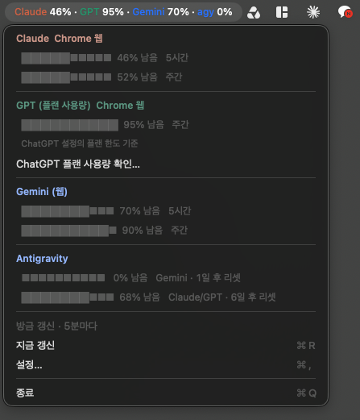

# AI Usage Bar

**Your remaining AI quota, right in your Mac menu bar.**

A free, open-source Mac menu bar app with **Claude · GPT · Gemini · agy** entries. Connect Claude, GPT and Gemini through Chrome, or keep using existing local logins and the agy CLI.

[한국어](README.md) · **English**

[**↓ Download for Mac — v1.2.1**](https://github.com/hong-minji/ai-usage-bar/releases/download/v1.2.1/AIUsageBar-1.2.1-universal.zip) · [Releases / latest version](https://github.com/hong-minji/ai-usage-bar/releases) · [Report an issue](https://github.com/hong-minji/ai-usage-bar/issues)

Targets macOS 13+ · One download for Apple Silicon and Intel · Korean app UI · MIT license

> This is an early public release. It is ad-hoc signed, without Apple Developer ID signing or notarization, so macOS may block the first launch. Read [First launch](#first-launch) below. Windows and Linux are not supported.



**Actual app screenshot; values change with usage. GPT displays the plan allowance from ChatGPT Settings → Usage.** There is one GPT entry with real plan figures, rather than a separate empty chat counter. Its menu links to the usage page to check which features count. Every percentage means **remaining, not used**. If a provider has multiple limits, such as a five-hour and weekly window, the menu bar shows the smallest remaining percentage. Open the menu for individual limits and reset times where available.

## Install with AI — guidance or hands-on help

**You can ask an ordinary web chat for installation instructions. To perform the installation on your Mac, the AI needs a local environment with permission to manage files and run commands on that Mac. Typing into a desktop app alone does not enable automatic installation.**

| AI environment | What it can help with |
|---|---|
| Ordinary ChatGPT/Claude web or desktop chat without a connection to your Mac | Read the README and explain steps; you download, move and open the app |
| A Codex/Claude Code terminal or desktop task running locally on your Mac | Download, extract and move the app within the granted permissions |
| Work/Cowork or another file-enabled task environment | Capabilities depend on local vs. cloud execution, connected tools and folder permissions; file access alone does not guarantee a complete Mac app installation |

**For hands-on installation, check that the task runs on “This computer” / locally.** Installing into a cloud environment does not install the app on your Mac. Feature names and availability depend on the app version and account. [Codex local environments](https://learn.chatgpt.com/docs/environments/modes) · [Claude Code surfaces](https://code.claude.com/docs/en/overview) · [Claude Cowork permissions](https://support.claude.com/en/articles/13345190-get-started-with-claude-cowork)

Send the repository URL and request below. The README includes downloads and connection instructions.

```text
https://github.com/hong-minji/ai-usage-bar

I'd like to install this app on my Mac. Read the README first.
Check whether this conversation can manage files and run commands on my Mac.
If it can, install the app ZIP from the latest release and connect only the
AI services I use. Otherwise, guide me through the download and installation
one step at a time. Tell me which sign-in, macOS approval and Chrome extension
steps I need to perform. Finally, explain how to verify the menu bar display
and usage refresh in my actual setup.
```

You may need to complete sign-in and macOS security approvals yourself. Do not paste passwords or authentication tokens into the chat. You can also install without AI by following the steps below.

## Download and get started

1. Use **Download for Mac** above to get `AIUsageBar-1.2.1-universal.zip`. The same file supports Apple Silicon and Intel.
2. Double-click the ZIP to extract it. It contains `AIUsageBar.app`, `START-HERE.txt` and `LICENSE.txt`.
3. **Move the app to Applications before opening it.** Choose its permanent location before connecting Chrome.
4. Find the app in the menu bar at the top of the screen. Open **설정…** (Settings) → **표시 항목** (Visible items) and keep only the services you use. There is no Dock icon.
5. Check the sign-in requirements below. For web logins, complete the one-time [Chrome setup](#connect-through-chrome-without-a-terminal).

The downloaded app does not require Xcode, Homebrew or Node.js. A provider's login tool or Chrome is needed only for that provider. GitHub's **Code → Download ZIP** and the **Source code** release assets contain source files; the runnable app is in `AIUsageBar-…-universal.zip` linked above.

### First launch

The app currently has an ad-hoc signature only. If you downloaded it from this repository and trust its origin, try opening it once, then go to **System Settings → Privacy & Security → Open Anyway**. See [Apple's official instructions](https://support.apple.com/en-us/102445). A managed work Mac may restrict this option.

macOS may also ask for Keychain access when connecting Claude. This lets the app read the existing Claude Code login. It never refreshes or changes the token.

## Supported services

| Label | What it measures | Without terminal tools | Existing local connection |
|---|---|---|---|
| **Claude** | Session and weekly quota | Claude signed in through Chrome + extension | Claude Code login |
| **GPT** | ChatGPT plan usage allowance | ChatGPT signed in through Chrome + extension | ChatGPT login in `~/.codex/auth.json` |
| **Gemini** | Gemini web quota | Gemini signed in through Chrome + extension | Uses Chrome |
| **agy** | Antigravity coding quota | Not supported | agy CLI installed and signed in |

Web connections for Claude, GPT and Gemini do not require CLI installation. **For local connections, installation alone is insufficient: you must also be signed in.** You do not need to leave a terminal window open or repeatedly enter commands. Codex depends on its local login file, not on whether you personally use its CLI.

**GPT scope, checked November 14, 2026:** Codex and ChatGPT Work currently share usage. OpenAI says Plus, Pro and Business will share ChatGPT/Codex allowance starting in December, excluding Instant chat. Do not assume all regular chats already count toward this figure. The app displays the reported plan allowance and does not estimate chat counts or separate model limits. [Official transition notice](https://help.openai.com/en/articles/20001625-understanding-chatgpt-and-codex-usage-limits) · [Current Work/Codex sharing](https://learn.chatgpt.com/docs/agent-configuration/speed)

Gemini web and agy also have separate quotas. This is not an API billing tracker.

- Choose visible services in Settings. agy is hidden by default; enable it only if you use the CLI.
- The app refreshes every five minutes and when its menu opens; its interval is configurable from 1–120 minutes.
- Chrome polls every five minutes while running. Opening the app menu reads the latest report; use Refresh now in the extension for an immediate web fetch.
- Failures show the previous successful reading with its age and an error, never a fabricated `0%`.
- Only usage queries are made. No model prompts are sent.

## Connect through Chrome without a terminal

The extension is bundled in the app and is not on the Chrome Web Store. Usage pages must be in Korean or English. Sign into the services in the Chrome profile you want to use.

1. In the installed app, open **설정… → 웹 연결 → Chrome 연결…** (Settings → Web connection → Connect Chrome). This registers the app and copies the extension folder path.
2. Open `chrome://extensions/` in that Chrome profile and enable **Developer mode**.
3. Choose **Load unpacked**, press **⌘⇧G**, paste, press **Enter**, then select the folder.
4. Open **AI 사용량 · 웹 연결** from Chrome's extension menu.
5. Turn on **Claude 웹 연결** and/or **GPT 플랜 웹 연결**. Gemini connects automatically as before.
6. Press the provider's **지금 갱신** (Refresh now). The app labels these readings **Chrome 웹** (Chrome web).

**Upgrading from v1.1.1?** Reload the extension and review its new Claude and ChatGPT site permissions. The new connection toggles are off by default.

Claude/GPT connection choices in the app:

| Choice | Behavior |
|---|---|
| 자동 (연결된 Chrome 우선) / Automatic | Uses an enabled Chrome connection when present, otherwise the existing local login |
| Chrome 웹만 — 터미널 불필요 / Chrome only | Reads browser reports without querying local credentials |
| 기존 로컬 로그인만 / Local only | Uses existing Claude Code / Codex credentials |

A browser error does not silently switch to a different local account. **Your browser and local apps may be signed into different accounts: check the Chrome profile you choose.** Claude/Codex reports use that profile's current signed-in account without collecting its email. Use one Chrome profile for the connection.

For Gemini, you can optionally pin a Google email in the extension popup. Otherwise it uses the current Google account. Unverifiable account identity is rejected.

The extension opens inactive usage tabs and closes them after reading. Tabs you select yourself are preserved. If you move the app, reconnect Chrome and load the extension from the new location. Keep the app and extension folder in place.

## Connect existing local logins

If you already signed into Claude Code or Codex, you can continue using that login. To choose the local account while Chrome is also connected, select **기존 로컬 로그인만** (Local only) in app Settings. Claude may ask for Keychain access.

agy requires CLI installation and sign-in. Set its executable path if automatic discovery fails. Hide agy if you do not use it.

## Update and uninstall

**Update:** Quit the existing app from its menu → download the new ZIP from [Releases](https://github.com/hong-minji/ai-usage-bar/releases) → replace the app in the same Applications location → reopen it. Updates are manual. Reload the web extension at `chrome://extensions/`. If the app moved, reconnect Chrome and toggle launch at login off and on.

**Uninstall:** In Settings, turn off **로그인 시 자동 실행** (Launch at login), quit, then move the app to Trash. If you connected Chrome, remove the extension and the registration file below. Remove the cache folder to erase usage history, and the preferences file to erase settings.

```text
Chrome registration: ~/Library/Application Support/Google/Chrome/NativeMessagingHosts/com.local.ai_usage_bar.gemini.json
Usage cache: ~/Library/Application Support/AIUsageBar/
App preferences: ~/Library/Preferences/com.local.ai-usage-bar.plist
Launch at login: ~/Library/LaunchAgents/com.local.ai-usage-bar.plist
```

Turning off launch at login removes its file. If you used the developer installer, also remove the Native Messaging registrations it created for other browsers.

## Privacy and access

- No developer server, analytics, advertising or telemetry. Usage requests go to the relevant service provider.
- Claude and Codex credentials are read only. The app never refreshes tokens or saves its own copy of them.
- The extension has site access to `claude.ai`, `chatgpt.com` and `gemini.google.com`. It extracts figures only from Claude/Codex usage settings and Gemini usage pages. It does not extract cookies, passwords or authentication tokens, or transmit conversation text.
- Claude/Codex web reports store only the provider, a fixed usage URL, time, percentages and quota labels. No emails, display names or page text are stored.
- Local caches contain usage, labels, plan information and timestamps. The Gemini bridge cache also contains the verified email, page URL and connection status. Cache file permissions are set to owner-only (`0600`).
- A pinned email and connection state are also kept in Chrome extension local storage, which is removed when the extension is uninstalled.

This is an independent app. Changes to a provider's authentication, responses or page layout can interrupt a connection or prevent readings.

## Troubleshooting

| Symptom | What to check |
|---|---|
| No window after opening the app | Look in the top menu bar. There is no Dock icon or regular app window. |
| macOS blocks launch | Follow First launch above and Apple's official guidance. |
| Claude login unavailable | Enable Chrome web access or check the existing Claude Code login and Keychain access. |
| GPT login unavailable | Enable Chrome web access or check the existing local Codex login. |
| GPT shows `–` | No plan reading is available yet. Check Chrome access or the existing local Codex login. |
| No web reading | Check extension reload, site permissions, service login and connection toggles. |
| Gemini needs a menu bar app connection | Click **Chrome 연결…** in the currently installed app and reload the extension. |
| Gemini shows old values | Check that Chrome is running and signed in, then press **지금 갱신** in the extension popup. |
| An unused service shows an error | Disable it under **설정… → 표시 항목**. |
| Antigravity fails | Check `agy` sign-in and the executable path. |

Still stuck? [Open an issue](https://github.com/hong-minji/ai-usage-bar/issues/new/choose) with the app version, macOS version, Mac architecture, affected service and reproduction steps. Do not include emails, tokens, authentication files or private conversations.

## Development and verification

Source builds require Xcode Command Line Tools. Run `xcode-select --install` and finish installation first.

```sh
git clone https://github.com/hong-minji/ai-usage-bar.git
cd ai-usage-bar
./build.sh
open build/AIUsageBar.app
```

```sh
./build.sh test                       # Swift checks
node --test ChromeExtension/*tests.cjs # Extension tests; requires Node.js
./package.sh                         # Both architectures, ZIP and SHA-256
./build/AIUsageBar.app/Contents/MacOS/AIUsageBar --once # One live check
```

For `v1.2.1`, 144 Swift checks and 33 extension tests passed, along with the universal build, ZIP extraction and signature verification. Live verification scope is recorded in the release notes. GPT shows the reported plan allowance; it does not estimate a separate chat counter. **Installation and execution have not been verified on macOS 13 or every supported Mac model.**

To verify file integrity, download the release ZIP and its `.sha256` file into the same folder, then run:

```sh
shasum -a 256 -c AIUsageBar-1.2.1-universal.zip.sha256
```

[Contributing](CONTRIBUTING.md) · [Gemini extension](ChromeExtension/) · [Release notes](docs/releases/v1.2.1.md)

## License

[MIT](LICENSE). Free to use, modify and redistribute. Provider accounts and subscriptions are separate. This project is not affiliated with or endorsed by Anthropic, OpenAI or Google.
