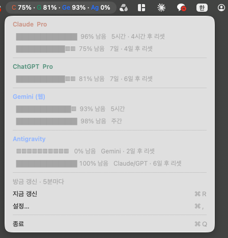

# AI 사용량 메뉴바

macOS 메뉴바에 Claude · ChatGPT(Codex) · Gemini 웹 · Antigravity의 **남은 사용량**을 한 줄로 표시합니다.



```
C 75% · G 81% · Ge 93% · Ag 0%
```

모든 숫자는 **남은 양**입니다. 작을수록 한도에 가깝습니다. 모델 표시는 각 서비스의 대표색을 유지하고, 퍼센트 숫자는 항상 흰색입니다. 한도가 여러 개면 가장 적게 남은 것을 메뉴바에 표시하고, 메뉴를 열면 전부 보여줍니다.

English documentation: [README.md](README.md)

## 왜 만들었나

AI 구독마다 한도도, 리셋 시각도, 확인하는 페이지도 전부 다릅니다. 작업 도중에 주간 한도를 치는 것도 번거롭지만, 모델이 거절할 때서야 알게 되는 게 더 나쁩니다. 그래서 네 개의 숫자를 이미 늘 보고 있는 곳(메뉴바)에 모으고, 인증 정보는 원래 있던 자리에 그대로 두었습니다.

## 무엇을 어떻게 읽나

| 표시 | 서비스 | 데이터 | 인증 |
|---|---|---|---|
| `C` | Claude 5시간 + 주간 한도 | `api.anthropic.com/api/oauth/usage` | Claude Code가 키체인에 저장해 둔 로그인 |
| `G` | ChatGPT **Codex** 한도 | `~/.codex/auth.json` + Codex 사용량 기록 | 기존 Codex 로그인 |
| `Ge` | **Gemini 웹** 한도 | `gemini.google.com/usage` | 기존 Chrome 로그인 (전용 확장 경유) |
| `Ag` | Antigravity 코딩 할당량 | `agy /quota` | `agy` CLI 자체 로그인 |

`G`는 일반 ChatGPT 채팅 한도가 아니라 **Codex** 한도입니다. Gemini 웹과 Antigravity도 서로 다른 예산입니다.

기본 5분마다, 그리고 메뉴를 열 때마다 갱신합니다. 특정 서비스 조회가 실패하면 그 항목만 영향을 받고, `0%`로 표시하는 대신 마지막 성공값과 경과 시간을 함께 보여줍니다(`72% · 2일 전`).

## 요구 사항

- macOS 13 이상
- Xcode Command Line Tools (`xcode-select --install`) — Xcode도, 패키지 매니저도, 외부 의존성도 없습니다
- 실제로 쓰는 서비스의 로그인: Claude Code, Codex, Chrome의 Google 로그인, `agy`. 쓰지 않는 항목은 설정에서 숨기면 됩니다.

## 설치

```sh
git clone https://github.com/hong-minji/ai-usage-bar.git
cd ai-usage-bar
./build.sh                 # 테스트 후 build/AIUsageBar.app 생성
open build/AIUsageBar.app
```

메뉴바 전용 앱이라 Dock 아이콘이 없습니다. 이전 버전이 실행 중이면 메뉴에서 먼저 종료하세요.

공증(notarize) 없이 로컬에서 임시 서명만 합니다. 직접 빌드한 앱이라 격리 속성이 없어 Gatekeeper 경고 없이 열립니다. Claude 로그인을 읽기 위해 macOS가 키체인 접근을 한 번 묻습니다. 읽기만 하며, 어떤 서비스의 토큰도 갱신하거나 변경하지 않습니다.

맥 시작과 함께 켜려면 설정에서 **로그인 시 자동 실행**을 켜세요.

## Gemini: 이미 로그인된 Chrome 세션 사용

Gemini는 로컬에서 읽을 수 있는 인증 파일이 없습니다. 그래서 별도 브라우저 로그인 대신 **Gemini 전용 Chrome 확장 프로그램**이 기존 프로필에서 사용량 페이지를 읽고, Chrome Native Messaging으로 숫자만 앱에 전달합니다.

```sh
./install-chrome-bridge.sh   # 최초 빌드 후 1회
```

그다음 Gemini에 로그인된 Chrome 프로필에서:

1. `chrome://extensions/`를 엽니다.
2. 오른쪽 위 **개발자 모드**를 켭니다.
3. **압축해제된 확장 프로그램을 로드합니다**를 누르고 이 프로젝트의 `ChromeExtension` 폴더를 선택합니다.
4. 확장 팝업에서 **지금 갱신**을 눌러 연결을 확인합니다.

앱에서는 **설정 → Gemini 웹 → Chrome 연결…** 버튼이 확장 관리 화면과 해당 폴더를 한 번에 열어줍니다.

**구글 계정이 여러 개라면?** 팝업의 계정 칸을 비워두면 현재 프로필에 로그인된 계정을 그대로 씁니다. 주소를 하나 입력하면 그 계정으로 고정되고, 다른 계정의 수치는 추측하지 않고 불일치 오류로 알려줍니다.

소스 폴더와 앱 번들 안의 복사본 중 **하나만** 설치하세요. 확장 ID는 둘 다 같습니다.

동작 방식:

- Chrome이 실행 중이면 5분마다 비활성 사용량 탭을 열어 읽고 닫습니다. 사용자가 직접 선택한 탭은 닫지 않습니다.
- 쿠키·비밀번호·토큰은 읽거나 복사하지 않습니다. 페이지에 표시된 계정과 사용 퍼센트만 앱으로 전달됩니다.
- 페이지에 렌더링된 계정을 확인할 수 있을 때만 수치를 채택합니다. 다른 계정의 수치나 읽지 못한 페이지는 `0%`가 아니라 오류로 표시됩니다.
- Chrome이 꺼져 있거나 세션이 만료되면 마지막 성공값과 경과 시간을 보여줍니다. Chrome 없이 조회하지 않습니다.
- 퍼센트를 읽으려면 페이지가 한국어 또는 영어로 표시되어야 합니다.

확장은 `gemini.google.com`에만 접근하고, 로컬 Native Messaging 호스트는 아래 확장 ID의 요청만 받습니다.

```
edmmoiejceaokbohcdedkehoabkgkole
```

이 ID는 `manifest.json`의 공개키로 고정됩니다. 공개 값이라 누가 설치해도 ID가 같습니다. 서명용 개인키는 이 저장소에 없으며, 확장은 Chrome 웹 스토어에 게시되지 않았습니다.

설치 스크립트가 만드는 파일은 하나뿐입니다.

```
~/Library/Application Support/Google/Chrome/NativeMessagingHosts/com.local.ai_usage_bar.gemini.json
```

전부 되돌리려면 Chrome에서 확장을 삭제하고 이 파일을 지우면 됩니다.

## 설정

메뉴바 아이콘 → **설정…** (`⌘,`):

| 항목 | 의미 |
|---|---|
| 갱신 주기 | 분 단위 갱신 간격 (1–120, 기본 5) |
| 표시 항목 | 메뉴바에 표시할 서비스 — Antigravity는 기본 꺼짐 |
| agy 경로 | `agy` 실행 파일 자동 탐색에 실패할 때 지정 |
| Gemini 웹 | Chrome 확장 설치 화면 열기 |
| 로그인 시 자동 실행 | LaunchAgent로 로그인 시 실행 |

경고·위험 색상 임계값은 각각 남은 20%, 5%가 기본입니다.

## 개인정보

- 아무 데로도 전송하지 않습니다. 모든 요청은 이미 계정이 있는 서비스로만 가고, 모든 값은 이 맥에 남습니다.
- 분석·텔레메트리·서버·외부 의존성이 없습니다.
- 인증 정보는 읽기만 합니다. 키체인의 Claude 항목, Codex 인증 파일, Chrome 세션 모두 소비만 합니다.
- 캐시는 `~/Library/Application Support/AIUsageBar/`에 `0600` 권한으로 저장됩니다.

## 문제 해결

| 증상 | 해결 |
|---|---|
| `설정에서 Gemini 크롬 연결을 완료하세요` | `./install-chrome-bridge.sh` 실행 후 확장을 로드하세요. |
| 팝업에 `메뉴바 앱 연결이 필요합니다` | Native 호스트가 등록되지 않았습니다. 빌드 후 `./install-chrome-bridge.sh`를 다시 실행하세요. |
| Gemini가 옛날 값에서 멈춤 | Chrome이 실행 중이어야 합니다. 팝업에서 지금 갱신을 누르세요. |
| 다시 빌드한 뒤 Claude 오류 | macOS가 키체인 접근을 다시 묻습니다. 한 번 허용하세요. |
| Antigravity가 안 보임 | 기본적으로 숨김입니다. 설정에서 켜고 필요하면 `agy` 경로를 지정하세요. |

## 개발

```sh
./build.sh test                                   # Swift 단위 테스트 (117개 검사)
node --test ChromeExtension/tests.cjs             # 확장 파서 + 워커 테스트
./build/AIUsageBar.app/Contents/MacOS/AIUsageBar --once   # 실제 조회 1회 출력
```

구조:

- `Sources/Sources.swift`, `Parsing.swift` — 서비스별 조회와 응답 파싱
- `Sources/GeminiChromeBridge.swift` — Native Messaging 호스트, 메시지 검증, 신선도 검사, 마지막 성공값 보존
- `Sources/Coordinator.swift` — 스케줄링, 서비스별 오류 격리
- `Sources/MenuBarController.swift`, `BarFormatter.swift` — 메뉴바 문자열과 상세 메뉴
- `ChromeExtension/` — 사용량 페이지 관찰, 계정 확인, 백그라운드 조회, 팝업
- `Tests/main.swift` — Swift 파싱과 연동 메시지 픽스처

두 테스트 모두 네트워크나 로그인 없이 실행됩니다.

## 라이선스

MIT — [LICENSE](LICENSE) 참고.
