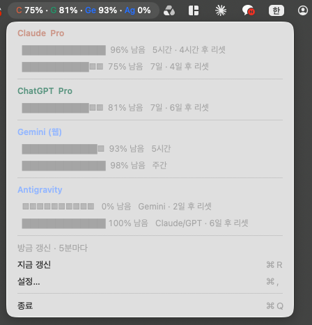

# AI Usage Bar

A macOS menu bar app that shows **how much of your AI quota is left** — Claude, ChatGPT (Codex), Gemini web and Antigravity — in one line.



```
C 75% · G 81% · Ge 93% · Ag 0%
```

Every number is **remaining**, not used — the smaller it gets, the closer you are to the limit. Each provider keeps its brand colour; the percentage is always white. When a provider has several windows (5-hour, weekly), the bar shows the tightest one and the dropdown lists them all.

> **Note** · The app UI is in Korean. Everything below works regardless of your system language. Korean documentation: [README.ko.md](README.ko.md)

## Why

Every AI subscription has its own limit, its own reset clock and its own page to check it. Hitting a weekly cap in the middle of a task is annoying; discovering it only when the model refuses you is worse. This puts all four numbers where you already look — the menu bar — and keeps every credential where it already lives.

## What it reads, and how

| Bar | Provider | Source | Auth |
|---|---|---|---|
| `C` | Claude 5-hour + weekly limits | `api.anthropic.com/api/oauth/usage` | The login Claude Code already stored in your Keychain |
| `G` | ChatGPT **Codex** limits | `~/.codex/auth.json` + Codex usage log | Your existing Codex login |
| `Ge` | **Gemini web** limits | `gemini.google.com/usage` | Your existing Chrome session, via a scoped extension |
| `Ag` | Antigravity coding quota | `agy /quota` | The `agy` CLI's own login |

`G` is the **Codex** quota, not the ChatGPT chat quota. Gemini web and Antigravity are separate budgets.

The app refreshes every 5 minutes by default and again when you open the menu. If a provider fails, only that entry degrades: it keeps showing the last good value with its age (`72% · 2 days ago`) instead of a misleading `0%`.

## Requirements

- macOS 13 or later
- Xcode Command Line Tools (`xcode-select --install`) — no Xcode, no Swift package manager, no dependencies
- Whichever providers you actually use: Claude Code signed in, Codex signed in, Chrome signed in to Google, `agy` installed. Missing ones can be hidden in Settings.

## Install

```sh
git clone https://github.com/hong-minji/ai-usage-bar.git
cd ai-usage-bar
./build.sh                 # runs the tests, then builds build/AIUsageBar.app
open build/AIUsageBar.app
```

The app is menu-bar only — no Dock icon. If an older copy is already running, quit it from its menu first.

It is signed ad-hoc (locally), not notarised. Because you built it yourself it is not quarantined, so it opens without a Gatekeeper prompt. macOS will ask once for Keychain access so the app can read the Claude login; it only reads, and never refreshes or rotates anyone's token.

Enable **로그인 시 자동 실행** (launch at login) in Settings if you want it to start with your Mac.

## Gemini: use the Chrome session you already have

Gemini has no local credential file to read, so instead of a second browser login this project ships a **Gemini-only Chrome extension** that reads the usage page in your existing profile and hands the two numbers to the app over Chrome Native Messaging.

```sh
./install-chrome-bridge.sh   # once, after the first build
```

Then, in the Chrome profile that is signed in to Gemini:

1. Open `chrome://extensions/`.
2. Turn on **Developer mode** (top right).
3. Click **Load unpacked** and select this project's `ChromeExtension` folder.
4. Open the extension popup and press **지금 갱신** (Refresh now) to confirm the connection.

In the app, **설정 → Gemini 웹 → Chrome 연결…** opens both the extensions page and the right folder for you.

**Multiple Google accounts?** Leave the popup's account field empty to use whichever account the profile is signed in to, or type one address to pin it — the app then accepts readings from that account only, and reports a mismatch instead of guessing.

Install either the source folder or the copy inside the app bundle, not both; the extension ID is the same for each.

How it behaves:

- While Chrome runs, the extension opens a background usage tab every 5 minutes, reads it, and closes it. A tab you have selected yourself is never closed.
- Cookies, passwords and tokens are never read or copied. Only the account shown on the page and the usage percentages reach the app.
- Numbers are only accepted when the account rendered on the page can be verified. Another account's figures, or an unreadable page, surface as an error — never as `0%`.
- If Chrome is closed or the session expires, the app shows the last good value with its age. Nothing is fetched without Chrome.
- The page must render in Korean or English for the percentages to be parsed.

The extension reaches `gemini.google.com` only, and the native messaging host accepts requests from this one extension ID:

```
edmmoiejceaokbohcdedkehoabkgkole
```

The ID is pinned by the public key in `manifest.json` — a public value, so the ID stays stable for everyone. The matching private key is not in this repository, and the extension is not published on the Chrome Web Store.

The install script writes exactly one file:

```
~/Library/Application Support/Google/Chrome/NativeMessagingHosts/com.local.ai_usage_bar.gemini.json
```

To undo the whole thing: remove the extension in Chrome and delete that file.

## Settings

Open the menu bar icon → **설정…** (`⌘,`):

| Setting | Meaning |
|---|---|
| 갱신 주기 | Refresh interval in minutes (1–120, default 5) |
| 표시 항목 | Which providers appear in the bar — Antigravity is off by default |
| agy 경로 | Path to the `agy` binary if it is not auto-detected |
| Gemini 웹 | Opens the Chrome extension setup |
| 로그인 시 자동 실행 | Launch at login, via a plain LaunchAgent |

Warning and danger colour thresholds default to 20% and 5% remaining.

## Privacy

- Nothing is sent anywhere. Every request goes to the provider you already have an account with, and every value stays on your Mac.
- No analytics, no telemetry, no server, no third-party dependency.
- Credentials are read, never written: the Claude Keychain item, the Codex auth file and the Chrome session are only ever consumed.
- Cached state lives in `~/Library/Application Support/AIUsageBar/`, written with `0600` permissions.

## Troubleshooting

| Symptom | Fix |
|---|---|
| `설정에서 Gemini 크롬 연결을 완료하세요` | Run `./install-chrome-bridge.sh` and load the extension. |
| `메뉴바 앱 연결이 필요합니다` in the popup | The native host is not registered — rerun `./install-chrome-bridge.sh` after a build. |
| Gemini stuck on an old value | Chrome must be running. Open the popup and press 지금 갱신. |
| Claude shows an error after a rebuild | macOS asks for Keychain access again; allow it once. |
| Antigravity missing | It is hidden by default. Enable it in Settings and set the `agy` path if needed. |

## Development

```sh
./build.sh test                                   # Swift unit tests (117 checks)
node --test ChromeExtension/tests.cjs             # extension parser + worker tests
./build/AIUsageBar.app/Contents/MacOS/AIUsageBar --once   # one real fetch, printed
```

Layout:

- `Sources/Sources.swift`, `Parsing.swift` — per-provider fetching and response parsing
- `Sources/GeminiChromeBridge.swift` — native messaging host, message validation, freshness, last-good retention
- `Sources/Coordinator.swift` — scheduling, per-provider error isolation
- `Sources/MenuBarController.swift`, `BarFormatter.swift` — the bar string and dropdown
- `ChromeExtension/` — usage page observation, account verification, background polling, popup
- `Tests/main.swift` — Swift parsing and bridge-message fixtures

Both test suites run without network access or a signed-in account.

## License

MIT — see [LICENSE](LICENSE).
